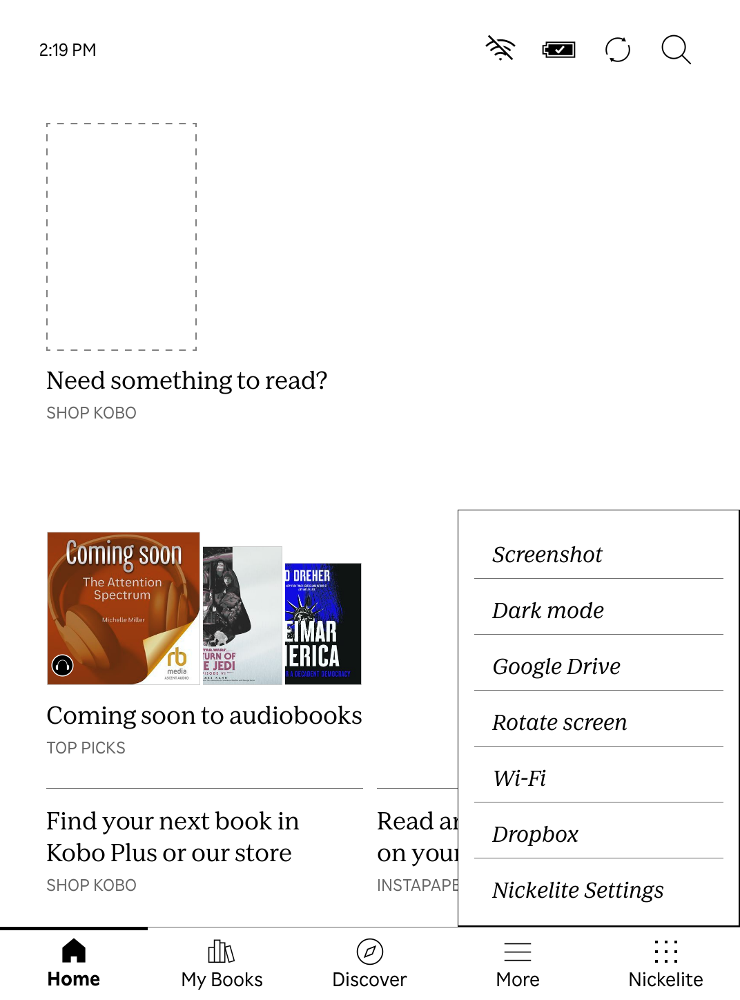
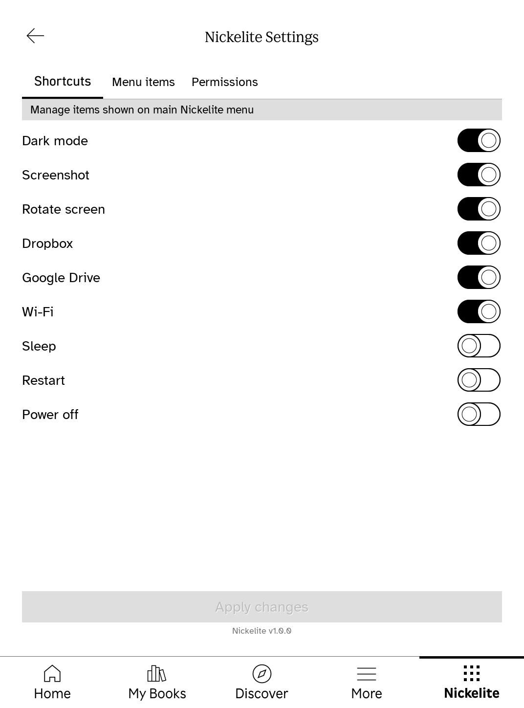
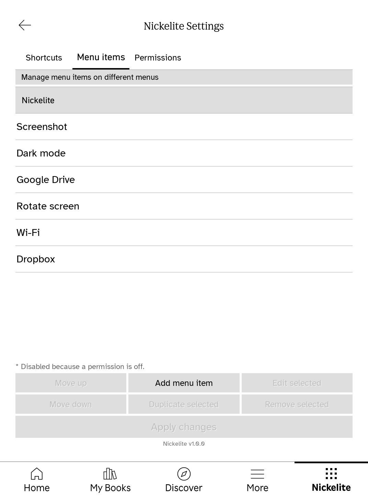
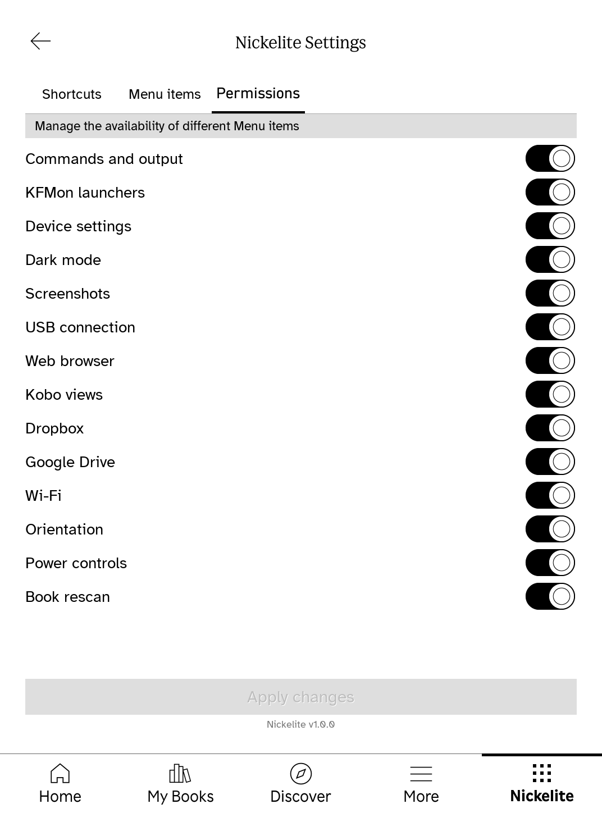
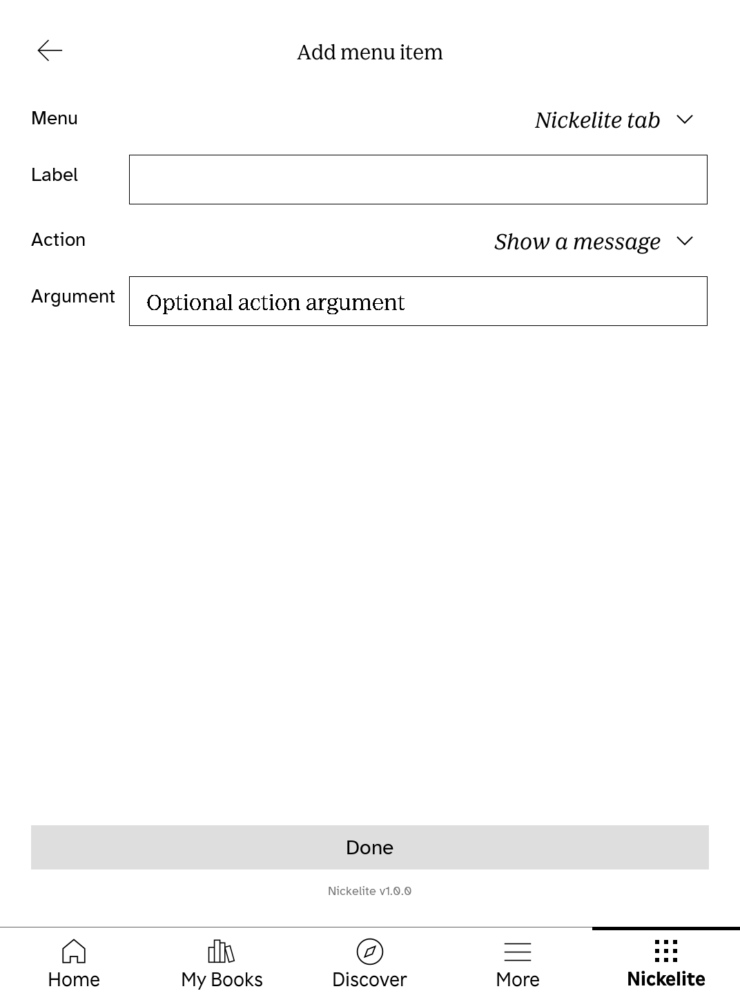

# Nickelite 1.0.0

Nickelite adds a configurable menu and a native Settings view to Kobo's Nickel reader software. It runs on the **Qt 6 based Kobo firmware 5+**. Firmware 4.x is outside this project's support scope.



## What it does

- Adds menu items to the Nickelite tab, the reading menu, and other supported Nickel menus. Items can run built-in actions, commands, or chained actions.
- Lets you add, edit, duplicate, remove, reorder, and enable shortcuts in a native Settings view. Changes to `.adds/nm` config files appear in Settings; changes made in Settings are saved back to those files and refresh the menu immediately.
- Provides shortcuts for screenshots, dark mode, orientation, Wi-Fi, power actions, Dropbox, and Google Drive. Permissions can disable individual action groups; blocked menu items remain visible but cannot run.
- Uses separate active and inactive tab icons. Optional popover styling adapted from [upstream PR #233](https://github.com/pgaskin/NickelMenu/pull/233) adds divider styling, width, position, and label style controls through `experimental:` config entries. The pointer option is included but has not rendered visibly in the Qt 6 simulator.
- Displays its version at the bottom of Settings. A firmware update may remove the plugin; reinstalling the package preserves the user config directory.

The optional [native popover style](docs/screenshots/popover-style.png) shows the upright labels, wider menu, and dividers from upstream PR #233 in the 6.0 simulator. These controls are off by default; see the `experimental:menu_main_15505_*` entries in the [config reference](res/doc).

| Firmware | Package | Evidence |
| --- | --- | --- |
| 5.18.270971 | `Nickelite-1.0.0-firmware-5.18.270971.zip` | Menu and Settings tested with a preceding editor candidate in QEMU; the 1.0.0 build loads its tab and passes ARM compatibility tests. Cloud access is not enabled for this firmware. |
| 6.0.279225 | `Nickelite-1.0.0-firmware-6.0.279225.zip` | Menu and Settings tested in QEMU; cloud lists, downloads, and USB actions tested on a physical Clara BW (N365) with preceding candidates. |

These are the **pinned firmware builds** for the 1.0.0 downloads. Other firmware 5.x/6.x builds and Kobo models need separate compatibility checks. The only physical model tested so far is **Kobo Clara BW**. The simulator runs genuine Nickel in QEMU userspace; it does not emulate Kobo hardware. See the [compatibility matrix](docs/feature-matrix.md), [6.0 results](docs/firmware-6.0.279225.md), and [simulator guide](docs/emulator/real-cloud.md).

## Download and install

Download the matching versioned ZIP and `SHA256SUMS` from the [v1.0.0 release](https://github.com/Sojaner/NickelMenuNg/releases/tag/v1.0.0). This repository is private, so downloads require GitHub access to it. Each ZIP contains `.kobo/Kobo.tgz`'s payload as `Kobo.tgz`, an internal checksum manifest, and, for 6.0.279225, an optional cloud shortcut config.

**Automated install:** connect the Kobo by USB, tap **Connect**, and find its mounted storage path. Install [GitHub CLI](https://cli.github.com/) and sign in with `gh auth login` if downloading from the private release. Run one of these commands from a clone of this repository:

The release also offers `install.sh` and `install.ps1` as separate downloads, so a clone is optional.

```sh
# Linux or macOS
./scripts/install.sh /path/to/KOBOeReader

# Windows PowerShell (replace E: with the Kobo drive)
.\scripts\install.ps1 -KoboDrive E:\
```

The scripts read `.kobo/version`, select the matching package, verify SHA-256 checksums, and stage `Kobo.tgz`. On 6.0.279225, they add cloud shortcuts only when there is no existing cloud shortcut, to avoid duplicates. To use a ZIP already downloaded from the release, pass its path as the second shell argument or `-Package` in PowerShell.

**Manual install:**

1. Download the ZIP matching the exact firmware version shown under **Settings → Device information**. Extract it on your computer.
2. Verify `Kobo.tgz` against the ZIP's `SHA256SUMS` (`sha256sum -c SHA256SUMS` on Linux, `shasum -a 256 -c SHA256SUMS` on macOS, or `Get-FileHash Kobo.tgz -Algorithm SHA256` on Windows).
3. Connect the Kobo by USB and choose its ordinary **Connect** prompt. Back up its `.adds/nm` directory if it exists. If `.adds/nm/uninstall` exists, remove that marker.
4. Copy `Kobo.tgz` to the mounted Kobo's `.kobo/Kobo.tgz`. For 6.0.279225, the ZIP also includes `cloud-shortcuts.conf`; copy it to `.adds/nm/cloud-shortcuts.conf` only if no Dropbox or Google Drive shortcuts already exist. You can also add those shortcuts in Nickelite Settings later.
5. Safely eject the Kobo storage and unplug it. Wait for the update to finish, then open the **Nickelite** tab. **Nickelite Settings** is the last menu item.

The installer preserves existing `.adds/nm` files. Cloud services also require a working Wi-Fi connection and account linking in Kobo's own screens. They are enabled only when Nickelite recognizes the tested N365 firmware library. Do not copy a package to an unlisted firmware version. To uninstall, create `.adds/nm/uninstall` and reboot; see [configuration help](res/doc).

## Settings and configuration





The **Shortcuts** tab controls ready-made menu entries. **Menu items** edits entries across target menus and groups them by target. **Permissions** controls whether actions are available. The editor writes new items to `.adds/nm/zz-nm-settings.conf`, while existing entries remain in their source files. It validates hand edits and asks before discarding unsaved changes. The interface uses page turns for long lists to suit e-ink latency.



For hand editing, add a separate text file under `.adds/nm`; do not edit `.adds/nm/doc`. See [the config reference](res/doc). The Settings view is available on both tested firmware versions. The USB connection action is available for custom items but is deliberately absent from ready-made shortcuts because it changes the device's storage connection state.

## Build and simulator

On Linux, build the Qt 6 SDK and package with Docker:

```sh
docker build -t nickelmenung-qt6-sdk -f toolchain/qt6/Dockerfile toolchain/qt6
docker run --rm --network none --user "$(id -u):$(id -g)" \
  -v "$PWD:/src" -w /src nickelmenung-qt6-sdk \
  sh -c 'make clean && make -j8 all kobo test/qt_compat test/compat'
./scripts/package-release.sh
```

The SDK build downloads Qt source and takes substantial time and disk space. The local `Kobo.tgz` is the production package; `scripts/package-release.sh` assembles versioned ZIPs in `dist/1.0.0`. The [simulator setup](docs/emulator/real-cloud.md) records firmware download, checksum verification, QEMU, VNC, network access, and optional cloud linking. Firmware, cloud tokens, and account data stay outside Git.

## Origins and license

Nickelite began as a fork of [Patrick Gaskin's NickelMenu](https://github.com/pgaskin/NickelMenu), with Qt 6 port work from [Nico Verbruggen](https://github.com/nicoverbruggen/NickelMenu) and the vendored [NickelHook](https://github.com/nicoverbruggen/NickelHook). The menu editor, native Settings view, permissions, tested cloud routes, firmware 5+/6 compatibility work, packaging, and simulator workflow are additions in this project. That wider scope calls for a name distinct from the original, so readers can tell its packages and support claims apart. **Nickelite** refers to the Nickel firmware through a material-inspired name, fitting an extension built on Nickel rather than another edition of NickelMenu. [Fyoosh's proposed popover styling](https://github.com/pgaskin/NickelMenu/pull/233) was adapted here. The original authorship and MIT license remain acknowledged in [LICENSE](LICENSE).
