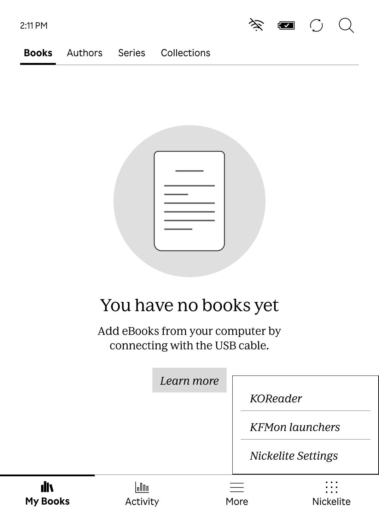
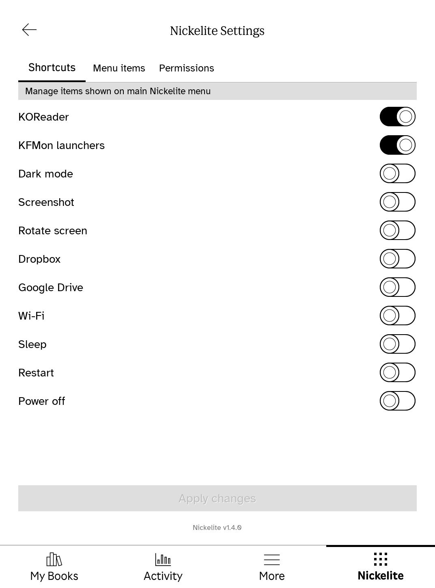
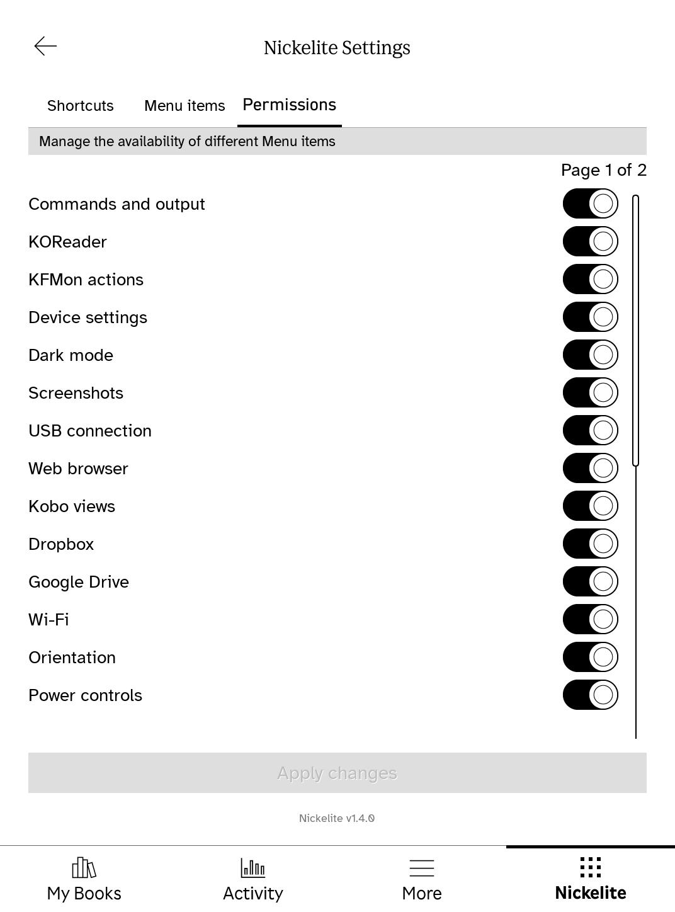
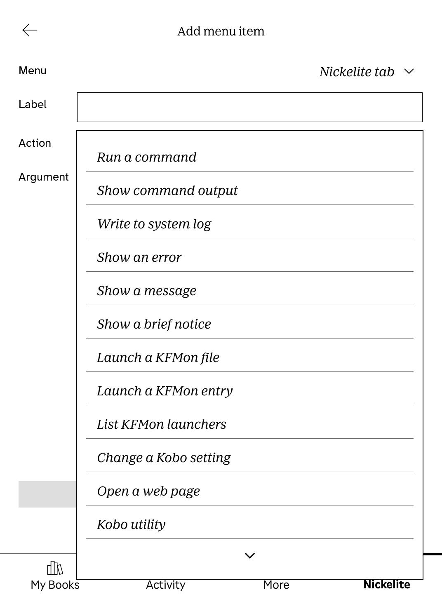
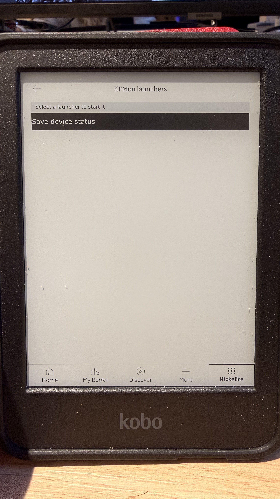

# Nickelite 1.4.0

Nickelite adds a configurable menu and a native Settings view to Kobo's Nickel reader software. It runs on the **Qt 6 based Kobo firmware 5+**. Firmware 4.x is outside this project's support scope.

The 1.4.0 QEMU screenshots below were captured from genuine Nickel 6.0.279225 in an isolated ARM userspace guest, with the 1.4.0 plugin, KOReader v2026.07.1 files, and the KFMon fork's 1.4.6 binary payload present. They show installed-app detection, Shortcuts, Permissions, and KFMon actions in Nickelite; they do not show KOReader runtime or KFMon daemon execution. QEMU has no Kobo framebuffer, so KFMon's FBInk daemon path is not runnable there. The legacy Menu, Menu items, and Permissions links below are older 1.1.1 captures. The KFMon picker photo is from a physical Clara BW running firmware 6.0.279225 and Nickelite 1.4.0.

[QEMU launchers](docs/screenshots/qemu-fw6-nickelite-launchers-1.4.0.jpg) · [QEMU Shortcuts](docs/screenshots/qemu-fw6-shortcuts-1.4.0.jpg) · [QEMU Permissions](docs/screenshots/qemu-fw6-permissions-1.4.0.jpg) · [QEMU KFMon Actions](docs/screenshots/qemu-fw6-kfmon-actions-1.4.0.jpg) · [Physical KFMon picker](docs/screenshots/kfmon-launcher-picker-1.4.0.jpg) · [Older Menu](docs/screenshots/main-menu.png) · [Older Menu items](docs/screenshots/settings-menu-items.png) · [Older Permissions](docs/screenshots/settings-permissions.png)

<p align="center"><a href="docs/screenshots/qemu-fw6-nickelite-launchers-1.4.0.jpg"></a> <a href="docs/screenshots/qemu-fw6-shortcuts-1.4.0.jpg"></a></p>
<p align="center"><em>QEMU firmware 6.0.279225 UI captures; app detection and Nickelite UI only, not app or daemon runtime.</em></p>

<p align="center"><a href="docs/screenshots/qemu-fw6-permissions-1.4.0.jpg"></a> <a href="docs/screenshots/qemu-fw6-kfmon-actions-1.4.0.jpg"></a></p>
<p align="center"><em>QEMU firmware 6 Permissions and Action choices; app detection/editor UI only. The native launcher picker on a physical Clara BW (N365), firmware 6.0.279225, is shown separately below.</em></p>

<p align="center"><a href="docs/screenshots/kfmon-launcher-picker-1.4.0.jpg"></a></p>
<p align="center"><em>Physical Clara BW (N365), firmware 6.0.279225, Nickelite 1.4.0.</em></p>

<p align="center"></p>

## What it does

- Adds menu items to the Nickelite tab, the reading menu, and other supported Nickel menus. Items can run built-in actions, commands, or chained actions.
- Lets you add, edit, duplicate, remove, reorder, and enable shortcuts in a native Settings view. Changes to `.adds/nm` config files appear in Settings; changes made in Settings are saved back to those files and refresh the menu immediately.
- Provides shortcuts for KOReader, screenshots, dark mode, orientation, Wi-Fi, power actions, Dropbox, and Google Drive. If KFMon is installed, Shortcuts can add its configured launcher list. Permissions can disable individual action groups; blocked menu items remain visible but cannot run.
- Uses separate active and inactive tab icons.
- Displays its version at the bottom of Settings. A firmware update may remove the plugin; reinstalling the package preserves the user config directory.

Kobo Clara BW (N365) does not normally show Dropbox or Google Drive in its More screen. On the tested 6.0.279225 firmware, Nickelite enables Kobo's built-in cloud views and their **My Dropbox** and **My Google Drive** entries in the native More screen:

<p align="center"></p>

| Firmware | Package | Evidence |
| --- | --- | --- |
| 5.18.270971 | `Nickelite-1.4.0-firmware-5.18.270971.zip` | Qt 6 cross-build, ARM compatibility, and OTA stage1 install/uninstall extraction checks passed in QEMU; the unsupported-firmware guard passed. The Settings UI and KFMon daemon framebuffer path could not be checked in QEMU. |
| 6.0.279225 | `Nickelite-1.4.0-firmware-6.0.279225.zip` | Qt 6 cross-build and ARM compatibility checks passed in QEMU. On a physical Clara BW (N365), the reviewed 1.4.0 build opened Home and all Settings views responsively. The installed-only KFMon shortcut opened the native launcher list; Back and the My Books bottom tab both closed it without a crash. Selecting the sample **Save device status** watch showed KFMon's success notification and wrote the expected report under `.adds/kfmon`. Permissions showed **KFMon actions**, and Add Action offered List, File, and Entry. The Shortcuts toggle added one menu row and removing it removed that row. KFMon firmware 6 uninstall and rollback have not been physically tested. On that Clara BW running firmware 6.0.279225, KOReader v2026.07.1 launched and responded, but `Exit > Exit` froze on the boot animation and required a non-erasing power cycle. `Exit > Reboot device` returned to Nickel normally; use that exit option on this tested device. These results do not establish behavior on other firmware versions or Kobo models. |

These are the **pinned firmware builds** for the 1.4.0 downloads. Other firmware 5.x/6.x builds and Kobo models need separate compatibility checks. The only physical model tested so far is **Kobo Clara BW**. The simulator runs genuine Nickel in QEMU userspace; it does not emulate Kobo hardware. See the [compatibility matrix](docs/feature-matrix.md), [6.0 results](docs/firmware-6.0.279225.md), and [simulator guide](docs/emulator/real-cloud.md).

## Download and install

Download the matching versioned ZIP and `SHA256SUMS` from the [public v1.4.0 release](https://github.com/open-source-arena/Nickelite/releases/tag/v1.4.0). Each ZIP contains `.kobo/Kobo.tgz`'s payload as `Kobo.tgz`, an internal checksum manifest, and, for 6.0.279225, an optional cloud shortcut config.

**Automated install:** connect the Kobo by USB, tap **Connect**, and find its mounted storage path. Install [GitHub CLI](https://cli.github.com/) to download the release automatically; sign-in is not required for this public repository. Run one of these commands from a clone of this repository:

The release offers `install.sh`, `install.ps1`, `install-kfmon.sh`, and `install-kfmon.ps1` as separate downloads, so a clone is optional. The default mode needs only its entrypoint; the optional KFMon mode needs `install.sh` beside `install-kfmon.sh`, or `install.ps1` beside `install-kfmon.ps1`.

```sh
# Linux or macOS
./scripts/install.sh /path/to/KOBOeReader

# Windows PowerShell (replace E: with the Kobo drive)
.\scripts\install.ps1 -KoboDrive E:\
```

The default scripts read `.kobo/version`, select the matching package, verify SHA-256 checksums, and stage `Kobo.tgz`. On 6.0.279225, they add cloud shortcuts only when there is no existing cloud shortcut, to avoid duplicates. To use a ZIP already downloaded from the release, pass its path as the second shell argument or `-Package` in PowerShell. Default install does not install KFMon.

**Manual install:**

1. Download the ZIP matching the exact firmware version shown under **Settings → Device information**. Extract it on your computer.
2. Verify `Kobo.tgz` against the ZIP's `SHA256SUMS` (`sha256sum -c SHA256SUMS` on Linux, `shasum -a 256 -c SHA256SUMS` on macOS, or `Get-FileHash Kobo.tgz -Algorithm SHA256` on Windows).
3. Connect the Kobo by USB and choose its ordinary **Connect** prompt. Back up its `.adds/nm` directory if it exists. If `.adds/nm/uninstall` exists, remove that marker.
4. Copy `Kobo.tgz` to the mounted Kobo's `.kobo/Kobo.tgz`. For 6.0.279225, the ZIP also includes `cloud-shortcuts.conf`; copy it to `.adds/nm/cloud-shortcuts.conf` only if no Dropbox or Google Drive shortcuts already exist. You can also add those shortcuts in Nickelite Settings later.
5. Safely eject the Kobo storage and unplug it. Wait for the update to finish, then open the **Nickelite** tab. **Nickelite Settings** is the last menu item.

The installer preserves existing `.adds/nm` files. Cloud services also require a working Wi-Fi connection and account linking in Kobo's own screens. They are enabled only when Nickelite recognizes the tested N365 firmware library. Do not copy a package to an unlisted firmware version. To uninstall Nickelite, create `.adds/nm/uninstall` and reboot; see [configuration help](res/doc).

**Optional KFMon install:** KFMon is a background watch service; Nickelite can list its configured launchers. Use the explicit installer mode only after Nickelite's update is fully complete and its `.kobo/Kobo.tgz` has been consumed. Connect by USB again, and run `./scripts/install.sh --kfmon /path/to/KOBOeReader` on Linux/macOS or `./scripts/install.ps1 -KoboDrive E:\ -KFMon` on Windows. This separate OTA flow stages only `.kobo/update.tar`. Both installer modes stop if `.kobo/Kobo.tgz`, `.kobo/KoboRoot.tgz`, `.kobo/update.tar`, or the temporary `.kobo/update.tar.tmp` is present. Never stage Nickel's `Kobo.tgz` and KFMon's `update.tar` together.

The release includes optional [KFMon install](dist/kfmon/KFMon-Nickelite-Install.zip), [uninstall](dist/kfmon/KFMon-Nickelite-Uninstall.zip), and [defaults](dist/kfmon/KFMon-Nickelite-Defaults.zip) assets. Verify their hashes in the release `SHA256SUMS`. The install/uninstall archives write system files only and do not alter `.adds` or animator scripts; the defaults asset is separate and will not overwrite an existing config. See [KFMon asset provenance and install details](dist/kfmon/PROVENANCE.md). Installation was exercised physically on firmware 6.0.279225, and OTA stage1 was simulated on the pinned firmware 5 and 6 updater scripts. Firmware 5 has not received a physical installation test.

For manual KFMon installation, finish the Nickelite update first, reconnect the Kobo, and confirm no updater file remains in `.kobo`. Verify `KFMon-Nickelite-Install.zip` against the release `SHA256SUMS`, extract `.kobo/update.tar` from it, and copy that file to the Kobo's `.kobo/update.tar`. Safely eject and unplug; the OTA updater installs KFMon and reboots. To remove it, use the same process with `KFMon-Nickelite-Uninstall.zip`. The defaults archive can be extracted to onboard storage and its `nickelite-defaults.sh` run on-device; it creates a default config only when one is absent.

On the pinned firmware builds, after a successful KFMon stage1 receipt the updater may still show its generic **Update failed** message. The fork deliberately exits nonzero after installing so those OTA scripts take their normal reboot path instead of selecting the recovery stage. This message alone does not verify whether installation completed; check for the receipt and then confirm KFMon in Nickelite after reboot.

## Settings and configuration

The **Shortcuts** tab controls ready-made menu entries. **Menu items** edits entries across target menus and groups them by target. **Permissions** controls whether actions are available. The editor writes new items to `.adds/nm/zz-nm-settings.conf`, while existing entries remain in their source files. It validates hand edits and asks before discarding unsaved changes. The interface uses page turns for long lists to suit e-ink latency.

To add KOReader, [install KOReader for Kobo](https://github.com/koreader/koreader/wiki/Installation-on-Kobo-devices) under `.adds/koreader`. When its executable launcher is present, Nickelite shows **KOReader** in Shortcuts and Permissions; enabling the shortcut adds the standard `/mnt/onboard/.adds/koreader/koreader.sh` launcher. The Menu items editor also offers a **Launch KOReader** preset. Both the KOReader and Commands permissions must be enabled for that launcher to run. Nickelite does not bundle KOReader. On the tested Clara BW (N365) running firmware 6.0.279225 with KOReader v2026.07.1, launch remained responsive, but **Exit → Exit** froze on the boot animation; choose **Exit → Reboot device** to return to Nickel on this device. Other firmware versions and Kobo models have not been checked. If your KOReader installer already added the same menu entry, the switch reflects that entry; avoid adding a second one.

When KFMon is installed, the **Shortcuts** tab offers a **KFMon launchers** toggle that adds one persistent menu item. Selecting it opens a picker for the configured, GUI-visible watches; if there are none, the list contains a disabled **No configured launchers** row and points to `.adds/kfmon/config`. The Menu items editor's Action list also offers **List KFMon launchers**, **Launch a KFMon file**, and **Launch a KFMon entry**. The **KFMon actions** permission controls all three; when disabled, these items are marked and cannot run. KFMon runs in the background and does not need an app-launch shortcut. Nickelite does not create KFMon watches; add a watch configuration under `.adds/kfmon/config` using [KFMon's instructions](https://github.com/NiLuJe/kfmon#how-can-i-add-my-own-actions), then reconnect USB or restart so KFMon reloads it. KFMon requires a `[watch]` section and absolute `filename` and `action` values; each value is limited to 128 characters. The filename basename must be unique. A visible icon file is needed for book-tap launch; KFMon 1.4.1+ also permits IPC-only watches whose trigger file is absent.

For example, save this as `.adds/kfmon/config/my-app.ini` (replace the paths and label):

```ini
[watch]
filename = /mnt/onboard/my-app-launcher.png
action = /mnt/onboard/.adds/my-app/launch.sh
label = My app
hidden = 0
```

The icon path should be visible to Nickel and its basename unique across KFMon watches. For an IPC-only watch on KFMon 1.4.1 or later, keep a unique absolute `filename` value but do not create the icon file. Ensure the action path exists and is executable. Nickelite Settings only manages the menu item; it does not create, write, or validate these watch files. The directory must already exist.

For a useful IPC-only check, [the device-status watch](docs/examples/kfmon-device-status.ini) runs [a small local script](docs/examples/kfmon-device-status.sh) that records the time, uptime, battery percentage when available, and free onboard space in `.adds/kfmon/device-status.txt`. It does not read books, account data, or network secrets. Copy the script to `.adds/kfmon/device-status.sh` and save the INI as `.adds/kfmon/config/nickelite-device-status.ini`, then reload KFMon by restarting Nickel or reconnecting USB. Select **Save device status** in the KFMon launcher list; read the result over USB. This watch was physically exercised on a Clara BW (N365) with firmware 6.0.279225. The Kobo executed the onboard script successfully; the host's view of VFAT permissions does not necessarily reflect device-side execution. The referenced trigger PNG is intentionally absent, which requires KFMon 1.4.1 or later.

For a fixed Menu items entry, use `kfmon` with the watch filename basename; this remains stable when KFMon reloads its config:

```ini
menu_item:main:Launch My app:kfmon:my-app-launcher.png
```

If the watch is removed or its filename changes, `kfmon` reports an invalid filename and launches nothing. `kfmon_id` can start a watch by its current numeric ID, but IDs may change after KFMon reloads or its configuration is shuffled; a stale ID can fail or start a different watch. Avoid saving that form as a long-lived shortcut. The **List KFMon launchers** action takes no argument and lets you choose a watch at runtime.

**List KFMon launchers** is terminal in an action chain: after it opens, later actions in that chain are skipped, whether the picker is closed or a watch is selected.

For hand editing, add a separate text file under `.adds/nm`; do not edit `.adds/nm/doc`. See [the config reference](res/doc). The Settings view is available on both tested firmware versions. The USB connection action is available for custom items but is deliberately absent from ready-made shortcuts because it changes the device's storage connection state.

## Build and simulator

On Linux, build the Qt 6 SDK and package with Docker:

```sh
docker build -t nickelmenung-qt6-sdk -f toolchain/qt6/Dockerfile toolchain/qt6
docker run --rm --network none --user "$(id -u):$(id -g)" \
  -v "$PWD:/src" -w /src nickelmenung-qt6-sdk \
  sh -c 'make clean && make -j8 all kobo test/qt_compat test/compat'
./scripts/package-release.sh
```

The SDK build downloads Qt source and takes substantial time and disk space. The local `Kobo.tgz` is the production package; `scripts/package-release.sh` assembles versioned ZIPs in `dist/1.4.0` and includes the optional KFMon release assets. The [simulator setup](docs/emulator/real-cloud.md) records firmware download, checksum verification, QEMU, VNC, network access, and optional cloud linking. Firmware, cloud tokens, and account data stay outside Git.

## Origins and license

Nickelite began as a fork of [Patrick Gaskin's NickelMenu](https://github.com/pgaskin/NickelMenu), with Qt 6 port work from [Nico Verbruggen](https://github.com/nicoverbruggen/NickelMenu) and the vendored [NickelHook](https://github.com/nicoverbruggen/NickelHook). The menu editor, native Settings view, permissions, tested cloud routes, firmware 5+/6 compatibility work, packaging, and simulator workflow are additions in this project. That wider scope calls for a name distinct from the original, so readers can tell its packages and support claims apart. **Nickelite** refers to the Nickel firmware through a material-inspired name, fitting an extension built on Nickel rather than another edition of NickelMenu. Nickelite is released under the [MIT License](LICENSE), retaining the original authorship notice. Vendored third-party code keeps its own notices, including the BSD-2-Clause notice in `src/kfmon_helpers.h`.
