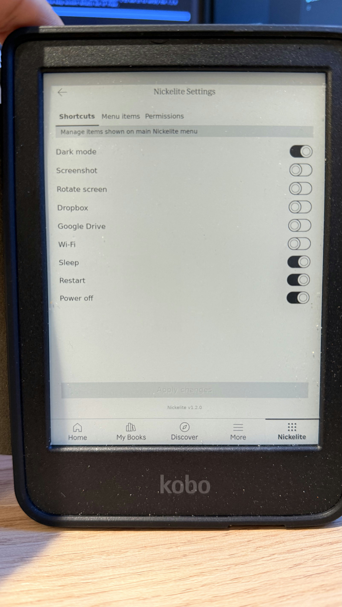
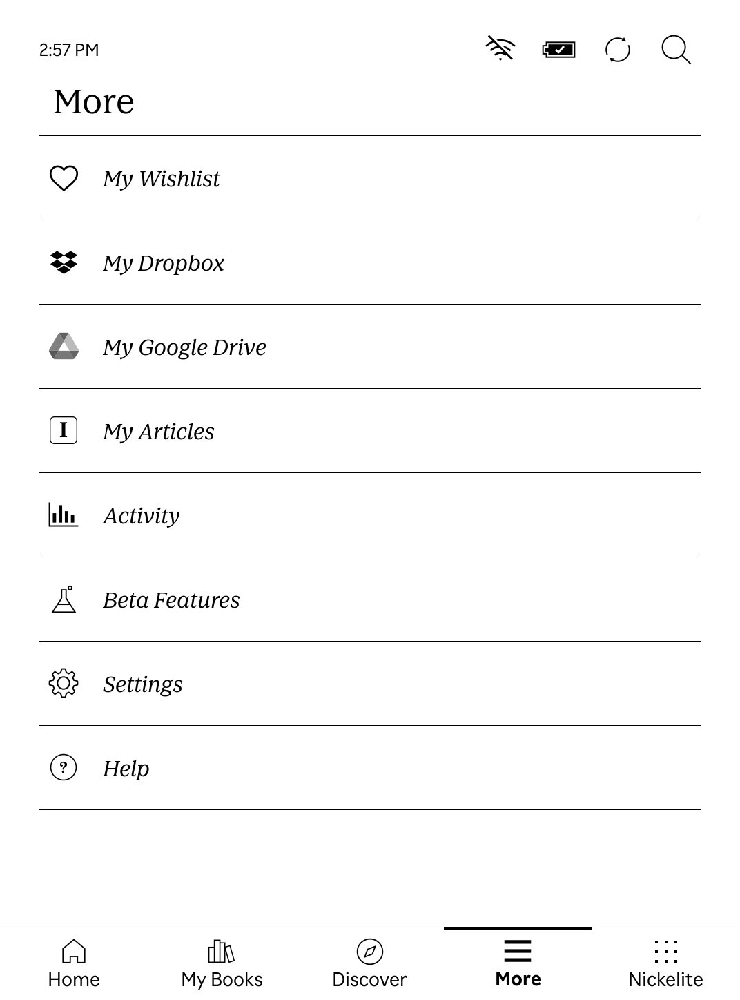

# Nickelite 1.3.0

Nickelite adds a configurable menu and a native Settings view to Kobo's Nickel reader software. It runs on the **Qt 6 based Kobo firmware 5+**. Firmware 4.x is outside this project's support scope.

Screenshots: Menu, Menu items, and Permissions are 1.1.1 simulator captures; Shortcuts is a physical Clara BW running 1.2.0 with KOReader absent. The simulator could not render Settings for refreshed captures.

[Menu](docs/screenshots/main-menu.png) · [Shortcuts](docs/screenshots/settings-shortcuts.jpg) · [Menu items](docs/screenshots/settings-menu-items.png) · [Permissions](docs/screenshots/settings-permissions.png)

<p align="center"></p>

## What it does

- Adds menu items to the Nickelite tab, the reading menu, and other supported Nickel menus. Items can run built-in actions, commands, or chained actions.
- Lets you add, edit, duplicate, remove, reorder, and enable shortcuts in a native Settings view. Changes to `.adds/nm` config files appear in Settings; changes made in Settings are saved back to those files and refresh the menu immediately.
- Provides shortcuts for KOReader, screenshots, dark mode, orientation, Wi-Fi, power actions, Dropbox, and Google Drive. Permissions can disable individual action groups; blocked menu items remain visible but cannot run.
- Uses separate active and inactive tab icons.
- Displays its version at the bottom of Settings. A firmware update may remove the plugin; reinstalling the package preserves the user config directory.

Kobo Clara BW (N365) does not normally show Dropbox or Google Drive in its More screen. On the tested 6.0.279225 firmware, Nickelite enables Kobo's built-in cloud views and their **My Dropbox** and **My Google Drive** entries in the native More screen:

<p align="center"></p>

| Firmware | Package | Evidence |
| --- | --- | --- |
| 5.18.270971 | `Nickelite-1.3.0-firmware-5.18.270971.zip` | Qt 6 cross-build, ARM compatibility, and OTA stage1 install/uninstall extraction checks passed in QEMU; the unsupported-firmware guard passed. The Settings UI and KFMon daemon framebuffer path could not be checked in QEMU. |
| 6.0.279225 | `Nickelite-1.3.0-firmware-6.0.279225.zip` | Qt 6 cross-build and ARM compatibility checks passed in QEMU. On a physical Clara BW (N365), KFMon 1.4.6 Nickelite fork install completed, Home stayed responsive, Settings detected KFMon, the generator listed a configured IPC-only watch, and tapping its `/bin/true` action returned success. The uninstall archive and firmware 6 rootfs rollback have not been physically tested. KOReader v2026.07.1 launched and responded, but `Exit > Exit` entered a frozen boot animation that required a non-erasing power cycle; `Exit > Reboot device` returned to Nickel normally. |

These are the **pinned firmware builds** for the 1.3.0 downloads. Other firmware 5.x/6.x builds and Kobo models need separate compatibility checks. The only physical model tested so far is **Kobo Clara BW**. The simulator runs genuine Nickel in QEMU userspace; it does not emulate Kobo hardware. See the [compatibility matrix](docs/feature-matrix.md), [6.0 results](docs/firmware-6.0.279225.md), and [simulator guide](docs/emulator/real-cloud.md).

## Download and install

Download the matching versioned ZIP and `SHA256SUMS` from the [public v1.3.0 release](https://github.com/open-source-arena/Nickelite/releases/tag/v1.3.0). Each ZIP contains `.kobo/Kobo.tgz`'s payload as `Kobo.tgz`, an internal checksum manifest, and, for 6.0.279225, an optional cloud shortcut config.

**Automated install:** connect the Kobo by USB, tap **Connect**, and find its mounted storage path. Install [GitHub CLI](https://cli.github.com/) to download the release automatically; sign-in is not required for this public repository. Run one of these commands from a clone of this repository:

The release offers `install.sh`, `install.ps1`, `install-kfmon.sh`, and `install-kfmon.ps1` as separate downloads, so a clone is optional. The default mode needs only its entrypoint; the optional KFMon mode needs `install.sh` beside `install-kfmon.sh`, or `install.ps1` beside `install-kfmon.ps1`.

```sh
# Linux or macOS
./scripts/install.sh /path/to/KOBOeReader

# Windows PowerShell (replace E: with the Kobo drive)
.\scripts\install.ps1 -KoboDrive E:\
```

The default scripts read `.kobo/version`, select the matching package, verify SHA-256 checksums, and stage `Kobo.tgz`. On 6.0.279225, they add cloud shortcuts only when there is no existing cloud shortcut, to avoid duplicates. To use a ZIP already downloaded from the release, pass its path as the second shell argument or `-Package` in PowerShell. Default install does not install KFMon.

**Manual install:**

1. Download the ZIP matching the exact firmware version shown under **Settings → Device information**. Extract it on your computer.
2. Verify `Kobo.tgz` against the ZIP's `SHA256SUMS` (`sha256sum -c SHA256SUMS` on Linux, `shasum -a 256 -c SHA256SUMS` on macOS, or `Get-FileHash Kobo.tgz -Algorithm SHA256` on Windows).
3. Connect the Kobo by USB and choose its ordinary **Connect** prompt. Back up its `.adds/nm` directory if it exists. If `.adds/nm/uninstall` exists, remove that marker.
4. Copy `Kobo.tgz` to the mounted Kobo's `.kobo/Kobo.tgz`. For 6.0.279225, the ZIP also includes `cloud-shortcuts.conf`; copy it to `.adds/nm/cloud-shortcuts.conf` only if no Dropbox or Google Drive shortcuts already exist. You can also add those shortcuts in Nickelite Settings later.
5. Safely eject the Kobo storage and unplug it. Wait for the update to finish, then open the **Nickelite** tab. **Nickelite Settings** is the last menu item.

The installer preserves existing `.adds/nm` files. Cloud services also require a working Wi-Fi connection and account linking in Kobo's own screens. They are enabled only when Nickelite recognizes the tested N365 firmware library. Do not copy a package to an unlisted firmware version. To uninstall Nickelite, create `.adds/nm/uninstall` and reboot; see [configuration help](res/doc).

**Optional KFMon install:** KFMon is a background watch service; Nickelite can list its configured launchers. Use the explicit installer mode only after Nickelite's update is fully complete and its `.kobo/Kobo.tgz` has been consumed. Connect by USB again, and run `./scripts/install.sh --kfmon /path/to/KOBOeReader` on Linux/macOS or `./scripts/install.ps1 -KoboDrive E:\ -KFMon` on Windows. This separate OTA flow stages only `.kobo/update.tar`. Both installer modes stop if `.kobo/Kobo.tgz`, `.kobo/KoboRoot.tgz`, `.kobo/update.tar`, or the temporary `.kobo/update.tar.tmp` is present. Never stage Nickel's `Kobo.tgz` and KFMon's `update.tar` together.

The release includes optional [KFMon install](dist/kfmon/KFMon-Nickelite-Install.zip), [uninstall](dist/kfmon/KFMon-Nickelite-Uninstall.zip), and [defaults](dist/kfmon/KFMon-Nickelite-Defaults.zip) assets. Verify their hashes in the release `SHA256SUMS`. The install/uninstall archives write system files only and do not alter `.adds` or animator scripts; the defaults asset is separate and will not overwrite an existing config. See [KFMon asset provenance and install details](dist/kfmon/PROVENANCE.md). Installation was exercised physically on firmware 6.0.279225, and OTA stage1 was simulated on the pinned firmware 5 and 6 updater scripts. Firmware 5 has not received a physical installation test.

For manual KFMon installation, finish the Nickelite update first, reconnect the Kobo, and confirm no updater file remains in `.kobo`. Verify `KFMon-Nickelite-Install.zip` against the release `SHA256SUMS`, extract `.kobo/update.tar` from it, and copy that file to the Kobo's `.kobo/update.tar`. Safely eject and unplug; the OTA updater installs KFMon and reboots. To remove it, use the same process with `KFMon-Nickelite-Uninstall.zip`. The defaults archive can be extracted to onboard storage and its `nickelite-defaults.sh` run on-device; it creates a default config only when one is absent.

On the pinned firmware builds, after a successful KFMon stage1 receipt the updater may still show its generic **Update failed** message. The fork deliberately exits nonzero after installing so those OTA scripts take their normal reboot path instead of selecting the recovery stage. This message alone does not verify whether installation completed; check for the receipt and then confirm KFMon in Nickelite after reboot.

## Settings and configuration

The **Shortcuts** tab controls ready-made menu entries. **Menu items** edits entries across target menus and groups them by target. **Permissions** controls whether actions are available. The editor writes new items to `.adds/nm/zz-nm-settings.conf`, while existing entries remain in their source files. It validates hand edits and asks before discarding unsaved changes. The interface uses page turns for long lists to suit e-ink latency.

To add KOReader, [install KOReader for Kobo](https://github.com/koreader/koreader/wiki/Installation-on-Kobo-devices) under `.adds/koreader`. When its executable launcher is present, Nickelite shows **KOReader** in Shortcuts and Permissions; enabling the shortcut adds the standard `/mnt/onboard/.adds/koreader/koreader.sh` launcher. The Menu items editor also offers a **Launch KOReader** preset. Both the KOReader and Commands permissions must be enabled for that launcher to run. Nickelite does not bundle KOReader. If your KOReader installer already added the same menu entry, the switch reflects that entry; avoid adding a second one.

When KFMon is installed, its permission and related actions appear in Nickelite Settings. The Menu items editor offers a **List KFMon launchers** generator preset; it adds a normal menu item that lists configured KFMon watches. KFMon runs in the background and does not need a shortcut of its own.

For hand editing, add a separate text file under `.adds/nm`; do not edit `.adds/nm/doc`. See [the config reference](res/doc). The Settings view is available on both tested firmware versions. The USB connection action is available for custom items but is deliberately absent from ready-made shortcuts because it changes the device's storage connection state.

## Build and simulator

On Linux, build the Qt 6 SDK and package with Docker:

```sh
docker build -t nickelmenung-qt6-sdk -f toolchain/qt6/Dockerfile toolchain/qt6
docker run --rm --network none --user "$(id -u):$(id -g)" \
  -v "$PWD:/src" -w /src nickelmenung-qt6-sdk \
  sh -c 'make clean && make -j8 all kobo test/qt_compat test/compat'
./scripts/package-release.sh
```

The SDK build downloads Qt source and takes substantial time and disk space. The local `Kobo.tgz` is the production package; `scripts/package-release.sh` assembles versioned ZIPs in `dist/1.3.0` and includes the optional KFMon release assets. The [simulator setup](docs/emulator/real-cloud.md) records firmware download, checksum verification, QEMU, VNC, network access, and optional cloud linking. Firmware, cloud tokens, and account data stay outside Git.

## Origins and license

Nickelite began as a fork of [Patrick Gaskin's NickelMenu](https://github.com/pgaskin/NickelMenu), with Qt 6 port work from [Nico Verbruggen](https://github.com/nicoverbruggen/NickelMenu) and the vendored [NickelHook](https://github.com/nicoverbruggen/NickelHook). The menu editor, native Settings view, permissions, tested cloud routes, firmware 5+/6 compatibility work, packaging, and simulator workflow are additions in this project. That wider scope calls for a name distinct from the original, so readers can tell its packages and support claims apart. **Nickelite** refers to the Nickel firmware through a material-inspired name, fitting an extension built on Nickel rather than another edition of NickelMenu. Nickelite is released under the [MIT License](LICENSE), retaining the original authorship notice. Vendored third-party code keeps its own notices, including the BSD-2-Clause notice in `src/kfmon_helpers.h`.
