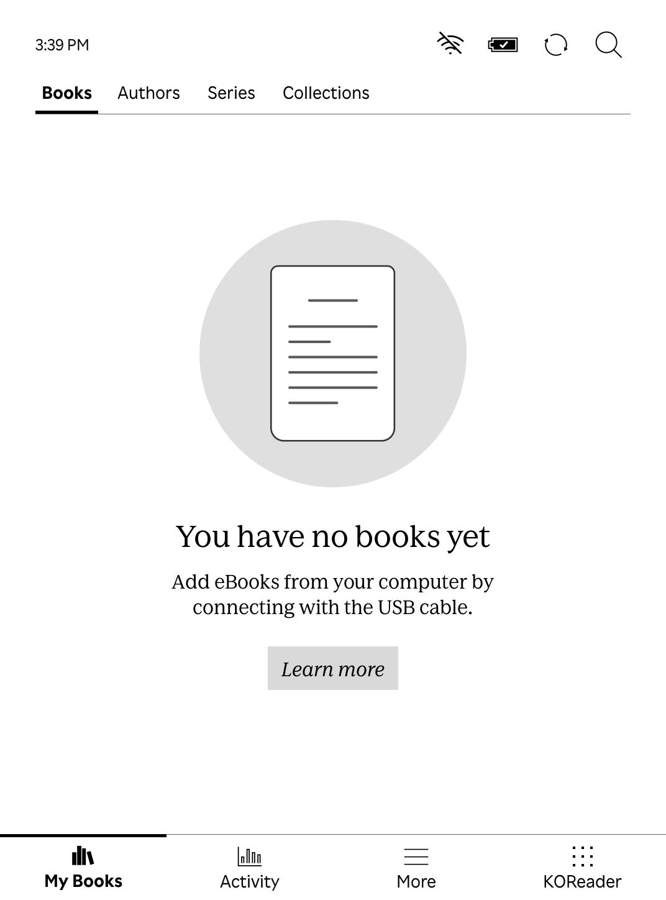
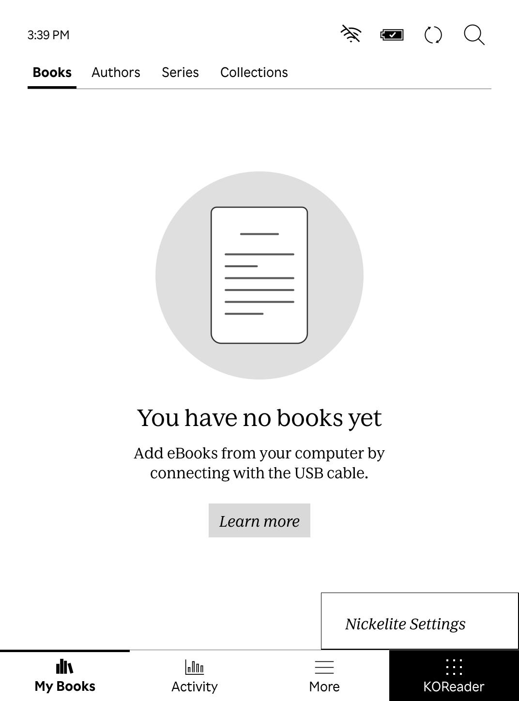

# Bottom tab action override

Nickelite can run one configured action when its bottom tab is tapped. This is
useful for opening an installed app such as KOReader directly. The override is
optional and lives outside `.adds/nm`, so NickelMenu does not parse or replace
it.

Create `.adds/nickelite/tab.ini` with one action and its regular argument:

```ini
action=cmd_spawn
argument=quiet:exec /mnt/onboard/.adds/koreader/koreader.sh
label=KOReader
```

`action` is a supported Nickelite action name. `argument` is required, even
when the chosen action takes an empty argument. `label` is optional and may
contain up to 32 characters. The file allows blank lines and `#` or `;`
comments, but rejects duplicate or unknown keys, malformed lines, unsupported
actions, and values over its size limits. It contains one action only; it does
not use the `menu_item:` config syntax and cannot contain an action chain.

A short tap runs the configured action through Nickelite's normal action
result handling. The tab action is an explicit override and does not use the
Settings permission switches. A press-and-hold opens the regular Nickelite
menu; releasing after a hold does not run the action. The configured label
remains visible while that menu or a Nickelite view is open.

If the override file is absent or invalid, the tab opens the regular Nickelite
menu. If the exact KOReader launcher action is configured but
`.adds/koreader/koreader.sh` is absent or not executable, a short tap also
opens the menu so the setting can be repaired. To recover from any other
misconfigured action, connect over USB and remove or rename
`.adds/nickelite/tab.ini`.

Other actions can use their existing Nickelite spelling and argument syntax.
For example, a KFMon watch can be started by its stable config filename:

```ini
action=kfmon
argument=my-app-launcher.png
label=My app
```

Do not use a numeric `kfmon_id` for a long-lived setting: IDs can change when
KFMon reloads or its config order changes.

## QEMU screenshots

These are direct captures from a genuine Nickel 6.0.279225 ARM userspace guest
with the 1.5.0 Nickelite plugin and an official KOReader package present on
synthetic onboard storage. The tab was configured to use the standard KOReader
launcher command. The first image shows its configured label at idle; the
second shows the NickelMenu opened by a press-and-hold. KOReader was not
launched in the guest, so these captures demonstrate UI behavior rather than
app runtime compatibility.

<p align="center"><a href="screenshots/qemu-fw6-tab-override-idle-1.5.0.jpg"></a> <a href="screenshots/qemu-fw6-tab-override-long-press-1.5.0.jpg"></a></p>

## Physical verification

On a Clara BW (N365) running firmware 6.0.279225, a short tap using a
temporary diagnostic action produced exactly one toast. Holding the tab opened
the Nickelite menu without running the action on release. A direct override
using the standard KOReader launcher started KOReader v2026.07.1. Choosing
**Exit → Reboot device** returned to responsive Nickel. Use that exit option on
this tested device; an earlier **Exit → Exit** attempt froze on the boot
animation and required a non-erasing power cycle. This does not establish
behavior on other Kobo models or firmware versions.

The tab may remain visually selected after running a direct action. Its focus
is retained because Nickelite Settings and KFMon views need the Nickelite tab
to stay active; no focus-reset behavior is applied after the action.
